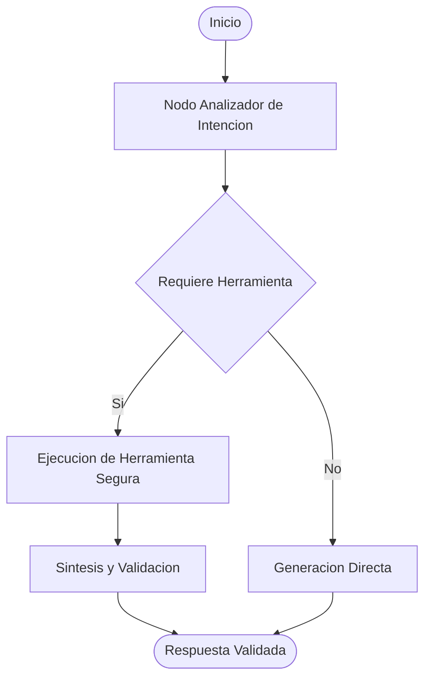

# Multi-Step Agentic Workflow using State Graphs

Implementacion de flujos de trabajo multi-agente deterministas utilizando grafos de estado (LangGraph). A diferencia de los bucles de agentes no restringidos, esta arquitectura modela las transiciones de forma explicita para evitar bucles infinitos y consumos imprevistos de tokens.

## Caracteristicas Principales
- Maquina de Estados Explicita: Control granular del ciclo de vida de la ejecucion y persistencia de memoria.
- Tool Calling con Validacion: Ejecucion controlada de herramientas externas bajo el principio de minimo privilegio.
- Mitigacion de Alucinaciones: Verificacion intermedia antes de emitir la respuesta final.

## Estructura del Flujo

